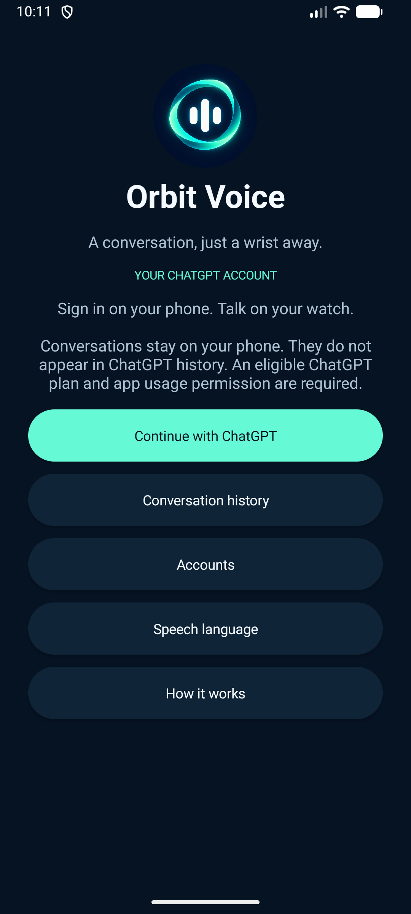
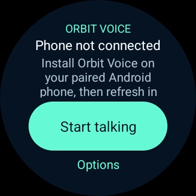
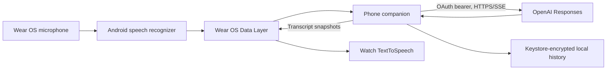

<p align="center"></p>

# Orbit Voice

An independent Wear OS voice assistant powered by your eligible ChatGPT account.
Speak on your watch, hear streamed answers, and keep the conversation going without
typing. An Android companion handles official account sign-in and encrypted local history.

**Status: early alpha.** The code implements the documented OpenAI open-source
sign-in flow. Real account authorization, paid-plan eligibility, and a complete
spoken conversation on paired physical devices require user verification. Read
[testing evidence](docs/testing.md) before treating this as a production app.

<p align="center"> </p>

## Features

- Official **Continue with ChatGPT** authorization, dynamic client registration,
  PKCE, signed ID-token validation, scope checks, and renewable access. No API key entry.
- Watch microphone input through Android's installed speech service.
- HTTP/SSE streaming with sentence-by-sentence TextToSpeech output.
- Automatic next-turn listening after speech playback, with interrupt and stop controls.
- A Wear OS Tile that opens the foreground conversation screen.
- Available models loaded from the signed-in account, rather than a fixed model name.
- Multiple account registrations with separate encrypted conversation histories.
- Resume, delete and export conversations as Markdown on the phone.
- English interface; selectable speech languages including Russian.
- Original launcher artwork and adaptive/themed icons.

## What to expect

This is a turn-based voice conversation: listen → recognize → stream an answer →
speak → listen again. It uses Android speech services and OpenAI Responses streaming.
It does **not** use ChatGPT's native Voice mode or claim Realtime Audio access through
the ChatGPT sign-in grant. There is no always-listening wake word. Leaving the
conversation screen stops the app's microphone and playback.

History stays on your Android phone. It does **not** appear in the ChatGPT website
or official mobile app. The documented open-source sign-in flow requires
`store: false`, and does not provide access to ChatGPT history. Markdown export is
the supported way to read a local conversation on another device.

OpenAI account eligibility and app usage permissions still apply. ChatGPT plan usage
is subject to the account's current limits and settings; this application does not
grant free or unlimited inference. Speech recognition and installed TTS voices may
also require network access or language downloads.

## Install the alpha

1. Download both APKs from [GitHub Releases](https://github.com/guberm/orbit-voice/releases).
2. Install `orbit-voice-phone-0.1.0-alpha.1.apk` on your Android phone (Android 11+).
3. Install `orbit-voice-wear-0.1.0-alpha.1.apk` on your Wear OS watch (Android API 30+).
4. Pair the watch using its manufacturer/Wear OS companion app. Both Orbit Voice
   APKs must come from the same release and have the same signing certificate.
5. On the phone, select **Continue with ChatGPT**, complete the OpenAI browser flow,
   and approve eligible ChatGPT plan usage. Return to Orbit Voice and choose a model.
6. On the watch, open Orbit Voice, use **Options → Refresh connection**, choose a speech language
   if needed, and tap **Start talking**. Grant microphone permission when prompted.
7. Add the Orbit Voice Tile from the watch's tile selector for quick launch.

The first browser sign-in is on the phone. Questions and answers need no keyboard
input. The phone supplies the OpenAI network connection; the watch app is not standalone.

For ADB installation, first identify the intended device with `adb devices -l`:

```powershell
adb -s PHONE_SERIAL install -r orbit-voice-phone-0.1.0-alpha.1.apk
adb -s WATCH_SERIAL install -r orbit-voice-wear-0.1.0-alpha.1.apk
```

Watch wireless debugging must already be paired/connected. Never install the phone
and watch APK on the same device: they intentionally share the application ID
`dev.orbitvoice.app` for Wear OS Data Layer communication.

## Build and test

Requirements: JDK 21, Android SDK platform 36, accepted Android SDK licenses, and
network access to Google Maven/Maven Central and the Gradle distribution.

Set `ANDROID_HOME` or create an ignored `local.properties` containing `sdk.dir`.
The checked-in Gradle wrapper verifies its distribution checksum.

```powershell
.\gradlew.bat :core:test :mobile:lintDebug :wear:lintDebug :mobile:assembleDebug :wear:assembleDebug
```

Device tests run on a dedicated phone emulator after ARTEMIS exploration:

```powershell
$env:ANDROID_SERIAL = 'YOUR_EMULATOR_SERIAL'
.\gradlew.bat :mobile:connectedDebugAndroidTest
```

Tests use isolated private storage and a local HTTPS mock server with synthetic
credentials. They do not sign in to a real OpenAI account, spend account usage,
or establish real watch/phone pairing.

For signed release builds, create your own key with
[`scripts/create-signing-key.ps1`](scripts/create-signing-key.ps1), then run
[`scripts/build-release.ps1`](scripts/build-release.ps1). Keys and passwords stay
outside the repository in the user's `.android` directory. Preserve your key to
sign compatible updates. CI builds debug APKs; it does not hold the maintainer's
release-signing key.

## Architecture



- `core`: JVM code for OAuth transactions, ID-token verification, SSE parsing,
  context replay, message validation, stale-response rejection, and speech chunking.
- `common`: Android Keystore storage, foreground voice sessions and shared UI helpers.
- `mobile`: browser sign-in, account-specific model selection, requests, local
  history and export, and a short-lived foreground service for watch requests.
- `wear`: round-screen conversation controls, phone discovery and a launch Tile.

OpenAI tokens never travel to the watch. Streaming snapshots carry request,
account and conversation identifiers plus sequence numbers. Cancelled, failed,
incomplete and interrupted requests do not become successful saved turns.

## Troubleshooting

| Symptom | Action |
| --- | --- |
| No phone connected | Install the phone APK, confirm Wear OS pairing, and use Refresh connection. |
| Open phone once message | Open Orbit Voice on the phone, then retry. Android may restrict starting a foreground service from the background. |
| Models unavailable | Check account eligibility, plan-sharing consent and ChatGPT Settings → Usage. |
| Authorization expired | Reconnect the selected account on the phone. |
| Voice input unavailable | Enable/install a compatible speech recognizer on the device. |
| Speech language unavailable | Install the corresponding TTS voice or choose another language. |
| Connection interrupted | Retry the turn. Partial speech may already have played, but the turn is not saved. |
| Local storage cannot unlock | The Keystore key may be unavailable. Do not clear app data unless you accept losing local history. |

## Privacy and upstream documentation

See [privacy](docs/privacy.md), [security](SECURITY.md),
[integration constraints](docs/feasibility.md) and [testing evidence](docs/testing.md).

Primary integration references:
[OpenAI open-source sign-in](https://developers.openai.com/siwc/token-sharing-open-source/sign-in),
[model and inference contract](https://developers.openai.com/siwc/token-sharing-open-source/models-and-inference),
[preview limitations](https://developers.openai.com/siwc/token-sharing-open-source/preview-limitations),
[Wear OS voice input](https://developer.android.com/training/wearables/user-input/voice),
[Wear OS Data Layer](https://developer.android.com/training/wearables/data/client-types).

Orbit Voice is not affiliated with, endorsed by, or an official product of OpenAI.
Code is available under the [MIT license](LICENSE).
