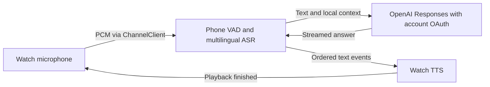

# Automatic language detection and continued conversation

Research date: October 13, 2026. Target: Pixel Watch 3 paired with Pixel 9 Pro XL.
This is a proposed architecture, not a claim that the replacement recognizer is implemented or benchmarked.

## Recommendation

Use watch microphone capture, a Wear OS ChannelClient audio stream, local multilingual Whisper inference on the phone, ChatGPT-account text inference, and watch TextToSpeech. Start with multilingual `base` as the accuracy baseline and compare `tiny` plus quantized variants on the actual phone before choosing the shipping model. Keep HTTP/SSE initially; evaluate Responses WebSocket after measuring the full speech pipeline.

This recommendation follows the accepted requirement: ChatGPT account authorization with local history. It does not require an additional cloud transcription account or API key.

## What is established

- The native automatic recognition route failed the user's Russian speech checks on the phone and watch: Russian was returned as English text. This observation does not distinguish mistranscription from actual translation inside the installed recognition service.
- Android's language detection and switching extras are optional and may have no effect depending on the recognizer. Switching also requires corresponding language models. Merely passing those extras cannot establish working automatic recognition. The default SpeechRecognizer documentation cautions against continuous recognition because implementations can use remote services and consume battery/bandwidth. [RecognizerIntent](https://developer.android.com/reference/android/speech/RecognizerIntent), [SpeechRecognizer](https://developer.android.com/reference/android/speech/SpeechRecognizer).
- The current Sign in with ChatGPT inference flow does not support audio/video input or the transcription API. It requires streamed, unstored Responses requests; HTTP conversation context must be supplied by the client. Using Codex app-server does not remove those limitations. [OpenAI preview limitations](https://developers.openai.com/siwc/token-sharing-open-source/preview-limitations).

## Alternatives

| Option | Fit for this application | Decision |
| --- | --- | --- |
| Native SpeechRecognizer automatic flags | Lowest integration cost; actual installed service failed the required behavior. | Explicit-language fallback only; do not advertise it as reliable automatic detection. |
| ML Kit GenAI Speech Recognition | Alpha API. Basic resembles native on-device recognition; Advanced currently lists Pixel 10/11, not the target Pixel 9. Its setup specifies a locale. | Not the primary route for this device pair. [Google documentation](https://developers.google.com/ml-kit/genai/speech-recognition/android). |
| whisper.cpp with multilingual Whisper | Android implementation, CPU support, language identification, source-language transcription, permissive licensing. | Preferred baseline. [whisper.cpp](https://github.com/ggml-org/whisper.cpp/blob/v1.9.5/README.md), [OpenAI Whisper](https://github.com/openai/whisper). |
| sherpa-onnx with Whisper | Valid Android/ONNX alternative; documented spoken-language identification uses multilingual Whisper too. Runtime choice alone does not improve the underlying model's Russian quality. | Retain as a benchmark alternative if integration or performance warrants it. [Language identification](https://k2-fsa.github.io/sherpa/onnx/spoken-language-identification/pretrained_models.html), [Whisper ASR](https://k2-fsa.github.io/sherpa/onnx/pretrained_models/whisper/index.html). |
| sherpa-onnx Omnilingual ASR | Broad multilingual coverage and Android examples; a distinct candidate requiring target-device quality, resource and license evaluation. | Secondary experiment, not assumed superior. [Project documentation](https://k2-fsa.github.io/sherpa/onnx/omnilingual-asr/index.html). |
| Moonshine | Attractive streaming architecture, but Russian STT is absent from the current published model table. TTS language coverage does not establish STT support. | Does not establish the required Russian/English solution. [Published models](https://moonshine-voice.readthedocs.io/en/latest/models/available-models/). |
| OpenAI hosted audio / native Realtime | Would need a separately authorized audio-capable API route and its billing; the existing account grant does not establish access. | Outside the accepted account-only design. |

## Recognition design

Use a multilingual model, never `base.en` or `tiny.en`. Russian is explicitly present in [Whisper's language vocabulary](https://github.com/openai/whisper/blob/main/whisper/tokenizer.py). For each completed speech segment, create fresh decoding parameters with `language="auto"`, `translate=false` and `no_context=true`. Obtain the detected language together with the transcript. Preserve dialogue context in the language-model request, separately from acoustic decoding.

In pinned whisper.cpp v1.9.5, `detect_language=true` is a detection-only operation that returns before transcription. Set `language="auto"` with `detect_language=false` for detection followed by transcription. Do not accidentally replace transcription with the detection-only flag. The implementation also exposes an abort callback and detected-language result. [Header](https://github.com/ggml-org/whisper.cpp/blob/v1.9.5/include/whisper.h), [Implementation](https://github.com/ggml-org/whisper.cpp/blob/v1.9.5/src/whisper.cpp).

The whisper.cpp model table estimates `tiny` at 75 MiB on disk / about 273 MB memory, and `base` at 142 MiB / about 388 MB. These are upstream estimates, not measured Android process peaks. Its Android sample recommends tiny/base. This supports offloading ASR to the phone, but does not prove latency or battery savings on these devices. [Model table](https://github.com/ggml-org/whisper.cpp/blob/v1.9.5/README.md#memory-usage), [Android example](https://github.com/ggml-org/whisper.cpp/blob/v1.9.5/examples/whisper.android/README.md).

Keep one loaded model during an active conversation, serialize decoding on a worker, and stop native work on cancellation. Do not repeatedly decode an expanding recording every few hundred milliseconds. Start with one decode per VAD-ended utterance. Short words, names, noise and mixed-language sentences require dedicated checks; automatic language identification is probabilistic. Do not silently lock all subsequent turns to the first detected language or force English on uncertainty.

## Audio transport and endpoint detection

Capture mono PCM16 at 16 kHz where supported, with explicit resampling otherwise. Raw payload is 32,000 bytes/second. Use ChannelClient for the continuous bytes; Google explicitly names streamed microphone voice as its use case. Keep MessageClient for small control/state/text events. Avoid DataClient audio storage and its synchronization semantics. [Wear OS client selection](https://developer.android.com/training/wearables/data/client-types).

Define a versioned channel header with session ID, turn ID, account/conversation binding, sample rate and encoding. Bound buffers, maximum turn duration and transfer timeouts; close on Stop/disconnect. Validate the sender and currently selected account before transcription/inference. End-of-channel alone must not turn a truncated transfer into a valid question.

Use speech VAD on the phone, with pre-roll and trailing padding so initial/final syllables survive. Silero supports 16 kHz and is a suitable candidate; whisper.cpp has an integration. Tune end-of-speech silence around 600–900 ms as an initial experiment, not a guaranteed optimal setting. A volume threshold alone is not sufficient proof of speech. [Silero VAD](https://github.com/snakers4/silero-vad), [whisper.cpp VAD](https://github.com/ggml-org/whisper.cpp/blob/v1.9.5/README.md#voice-activity-detection-vad).

Discard audio after decoding; persist text history only. Verify local TTS voice availability independently from ASR languages.

## Continued conversation

Use an explicit session state machine:

`Idle → Listening → Transcribing → Responding/Speaking → Listening`

- A start action creates a session that remains active across turns. Silence means waiting, not ending the dialogue.
- Next-turn capture starts only after both response completion and the final TTS queue callback. OpenAI finishing generation does not mean playback has finished. A phone coordinator needs the watch's playback-finished acknowledgement.
- Each turn has an ID/generation; cancellation invalidates microphone capture, channels, native decoding, network events and queued TTS. Reject late callbacks. Save completed turns only, and never automatically resend an uncertain paid request after disconnect.
- Replay the selected local conversation to OpenAI on HTTP requests. Preserve account isolation. The current `Conversation.request`, `Engine` completion-only commit and `Wire.Gate` are useful existing components.
- Start with alternate listening/speaking phases. Supporting speech interruption during playback is a separate step: AEC, audio-focus handling, interruption thresholds and cancellation must be measured on the watch speaker. Android exposes AEC availability checks; availability alone does not establish effective echo removal. [AcousticEchoCanceler](https://developer.android.com/reference/android/media/audiofx/AcousticEchoCanceler).
- Current activities stop voice work in `onStop`. For conversation across display sleep, move capture ownership to a microphone foreground service started from the visible app with granted RECORD_AUDIO. A Tile should open the app to start the session. Do not assume a background listener may start microphone capture. [Android foreground-service requirements](https://developer.android.com/develop/background-work/services/fgs/service-types#microphone).

## Latency and implementation sequence

Measure end-of-speech → final transcript → first response text → first audible answer separately. Stream audio while recording, preload ASR, and begin TTS on stable sentence boundaries. Evaluate compression only if channel throughput or battery measurements justify its extra codec work.

Responses WebSocket can continue connection-local responses, but reconnection loses that cache; local context remains necessary. It is a text transport optimization here, not native voice access. Preserve the tested SSE path until target-account WebSocket tests and timing show a benefit. [Responses WebSocket recovery](https://developers.openai.com/api/docs/guides/websocket-mode#reconnect-and-recover), [Account-flow requirements](https://developers.openai.com/siwc/token-sharing-open-source/models-and-inference).

Implementation order: phone ASR benchmark with recorded Russian/English samples; capture/VAD; channel protocol; session state machine and playback acknowledgement; physical-device dialogue checks; then final signed release. Pin code/model revisions and verify downloaded model hashes. Keep ASR weights off the watch.

Release acceptance must include Russian → English → Russian without settings, first-utterance Russian, names/numbers/short answers, silence/noise, two contextual turns without button presses, Stop at every phase, disconnect/reconnect, missing TTS voice, and lock/screen-sleep behavior. Measure warm/cold p50/p95 latency, peak memory and sustained conversation power/temperature. No latency, accuracy, uninterrupted screen-off conversation or replacement-ASR success is claimed yet.

## Current implementation boundary

At this checkpoint the native recognizer is still the active implementation. The Whisper submodule and a locally downloaded model are preparation only; no JNI decoder or watch audio channel is integrated. Existing successful build and instrumentation logs verify earlier auth/continuation fixes, not this proposed ASR pipeline. Do not publish a release claiming automatic multilingual recognition until the physical-device acceptance checks pass.
